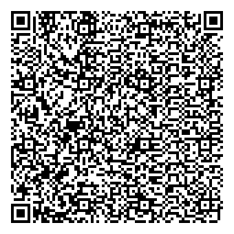
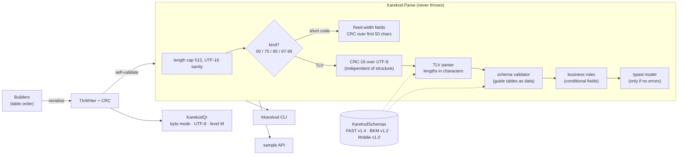
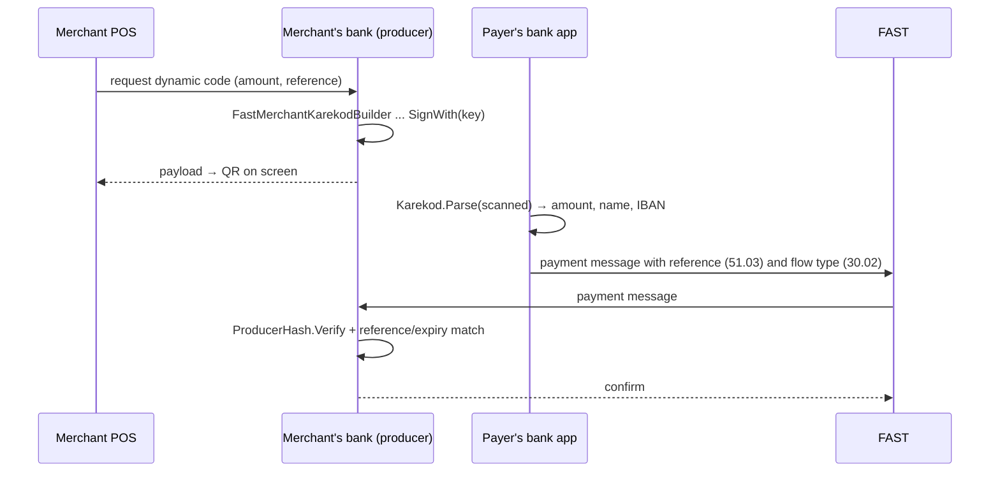

# trkarekod

[](https://github.com/hekimcan206/trkarekod/actions/workflows/ci.yml)
[](https://github.com/hekimcan206/trkarekod/actions/workflows/codeql.yml)
[](LICENSE)
[](https://dotnet.microsoft.com/)

A .NET library, CLI and sample API that **parses, validates, generates and renders TR Karekod**, the Turkish national
payment QR code. It is checked against every sample payload published in the official guides: it parses all seven,
and its builders reproduce them **byte for byte, CRC included**.

## The problem

TR Karekod is the QR code standard the Central Bank of the Republic of Türkiye (TCMB) made mandatory for QR payments
in 2020 (Resmî Gazete no. 31220). It is based on EMVCo Merchant-Presented Mode: a string of `ID + length + value`
data objects ending in a CRC-16. FAST (the TCMB instant payment system), BKM card payments and mobile payments each
add their own templates. The format looks simple, and that is the trap:

- **Lengths are characters, the CRC is over UTF-8 bytes.** A code for a shop in `İSTANBUL` is valid only if the
  generator counts `İ` as one character and hashes it as two bytes. Code that is correct for ASCII breaks on the
  first Turkish letter. The official FAST sample proves which rule is right (its CRC `3F2E` only reproduces over UTF-8;
  over Latin-1 it is `513B`).
- **Short codes break the long-code rule.** Their CRC has no `6304` prefix, even though one guide's prose says it
  does. Only the published samples settle it.
- **The rules are spread over tables in four documents**: mandatory, optional and conditional fields, a 12-digit
  kuruş amount (not EMVCo's decimal string), and conditional rules such as "a dynamic code needs an amount and an
  expiry" or "a refund needs the original payment reference and purpose 00".
- **The CRC is not security.** Anyone can change the IBAN on a sticker and recompute it in five lines.

## What is in the box

| Part | What it does |
|---|---|
| `TrKarekod` (NuGet, no dependencies) | `Karekod.Parse` → kind, typed model, CRC status and diagnostics; builders for static, dynamic and refund FAST codes, person-to-person and short codes; `ProducerHash` for authenticity |
| `TrKarekod.Cli` (`dotnet tool`) | `trkarekod parse`, `build fast/p2p`, `render` (PNG), `vectors` self-check, `codes` |
| `vectors/trkarekod-vectors.json` | 7 official samples + 30 derived vectors (29 invalid, each breaking one rule), with expected diagnostics and parsed fields; usable by any implementation |
| `samples/TrKarekod.Api` | HTTP API: issue signed codes, parse, verify (integrity, authenticity, expiry), render PNG |

Supported usage models: merchant-presented long code (FAST 30/31, BKM 26, mobile 32), FAST person-to-person (75),
short codes (97 FAST, 99 BKM, 96 either) and consumer-presented (85, structure and CRC only).

## Quick start

```csharp
using TrKarekod;
using TrKarekod.Building;
using TrKarekod.Model;

// Read: never throws for bad input.
var result = Karekod.Parse(scannedText);
if (result.IsValid && result.Merchant is { } m)
{
    Console.WriteLine($"{m.MerchantName}, {m.MerchantCity}: {m.Amount} TL to {m.Fast?.Iban}");
}
else
{
    foreach (var d in result.Errors) Console.WriteLine(d);  // error TRK011 [63]: CRC is 3F2E but the payload hashes to ...
}

// Write: a dynamic, signed FAST code. Build() validates its own output with Karekod.Parse.
var now = KarekodTimestamp.TurkeyNow();
string payload = new FastMerchantKarekodBuilder()
    .Dynamic(amount: 150.50m, expiresAt: now.AddMinutes(10))
    .Iban("TR330006100519786457841326")
    .SignWith(producerKey)                         // 30.20 = HMAC-SHA256(IBAN, amount, reference, expiry)
    .Producer("0010", reference: "POS1-000123", createdAt: now)
    .Merchant("ABC GIDA", "İSTANBUL", mcc: "5499")
    .PaymentPurpose("01")
    .Build();

// Bank side, when the payment message echoes the code back:
bool ours = ProducerHash.Verify(producerKey, Karekod.Parse(payload).Merchant!);
```

CLI (official FAST sample from the TCMB guide):

```text
$ trkarekod parse "00020101021230920016TR.GOV.TCMB.FAST0126TR1234...6008İSTANBUL...63043F2E"
MerchantPresented: VALID (CRC ok)
  00     Payload format indicator............... 01
  01     Point of initiation.................... 12
  30     FAST merchant account
    30.00  Globally unique identifier........... TR.GOV.TCMB.FAST
    30.01  Merchant IBAN........................ TR123456789012345678901234
    30.02  Flow type............................ 01
    30.20  Security hash........................ E200C014A30EFCDC7E9F379CE0766A68
  49     Merchant code.......................... 0023415672
  50     Location............................... 3993942332851791
  51     Karekod identity
    51.00  TR Karekod version................... 10
    51.02  Producer code........................ 0010
    51.03  Reference number..................... 23451017
    51.04  Terminal type........................ 02
    51.05  Terminal serial number............... 12345678901234567890ABC
    51.06  Created at........................... 200729153059
    51.07  Expires at........................... 200729163059
  52     Merchant category code................. 5499
  53     Transaction currency................... 949
  54     Transaction amount..................... 000000015050
  58     Country code........................... TR
  59     Merchant name.......................... ABC GIDA
  60     Merchant city.......................... İSTANBUL
  61     Postal code............................ 34100
  62     Additional data
    62.01  Bill number.......................... TLK01230405
    62.02  Mobile number........................ 903125075000
    62.03  Store label.......................... AVMSTR
    62.04  Loyalty number....................... 2315634123
    62.06  Customer label....................... 0518894111
    62.08  Purpose of transaction............... 09
  63     CRC.................................... 3F2E
warning TRK045 [30.01]: IBAN fails the mod-97 check; it looks like a placeholder or a typo.
```

The same payload rendered by `trkarekod render ... --scale 4` (QR version 15, decoded back with ZXing in the tests):



Demo stack (API on `localhost:58290`, plus a container that checks all 37 published vectors):

```bash
docker compose up --build
curl -s localhost:58290/v1/karekod/fast -H 'Content-Type: application/json' \
  -d '{"iban":"TR330006100519786457841326","merchantName":"Kafe 42","city":"ANKARA","reference":"POS1-1","paymentPurpose":"01","amount":87.50,"expiresInMinutes":5}'
```

The API also serves `POST /v1/karekod/parse`, `/verify` and `/render` (PNG). OpenAPI is at `/openapi/v1.json`.

## Architecture





## Why this design

- **Characters for lengths, UTF-8 for the CRC**, decided by the official sample rather than by guessing. Two negative
  vectors guard the decision ([ADR 0001](docs/adr/0001-character-lengths-and-crc-over-utf8.md)).
- **The guides' tables as data.** Each row carries the Turkish field name from the PDF, so review is a side-by-side
  comparison. Only the conditional rules are code. Builders emit in table order, which is why they can reproduce the
  samples exactly ([ADR 0002](docs/adr/0002-guide-tables-as-data.md)).
- **Diagnostics, not exceptions.** Scanned input is hostile by default. Every problem gets a stable code, a path
  (`62.08`) and an offset. The CRC is checked independently, so damaged prints say "CRC mismatch". Typed models exist
  only for valid codes. Builders run the parser on their own output, so they cannot emit a code payers would reject
  ([ADR 0003](docs/adr/0003-diagnostics-not-exceptions.md)).
- **QR symbols carry exactly the hashed bytes**: byte mode, UTF-8, no ECI. This is verified by decoding every sample
  with ZXing ([ADR 0004](docs/adr/0004-qr-symbol-encoding.md)).
- **Authenticity is separate from integrity.** 30.20 can hold an HMAC that only the producer can verify. CI forges a
  code with a correct CRC and checks that verification rejects it ([ADR 0005](docs/adr/0005-producer-hash-convention.md)).
- **Zero dependencies in the core package**: rendering lives in a separate assembly, which keeps the supply chain
  small for payment backends ([threat model](docs/threat-model.md)).

## Test vectors

All official samples, transcribed from the PDFs and confirmed by their published CRCs:

| Vector | Source | Kind | CRC | Builder reproduces it |
|---|---|---|---|---|
| FAST dynamic sale (`İSTANBUL`) | TCMB FAST guide v1.4, Table 1 | merchant-presented | `3F2E` | yes, byte for byte |
| FAST refund (flow 04) | TCMB FAST guide v1.4 | merchant-presented | `8B01` | yes |
| FAST person-to-person | TCMB FAST guide v1.4, Table 3 | 75 | `5E7C` | yes |
| FAST short code | TCMB FAST guide v1.4, Table 2 | 97 | `5BFD` | yes |
| BKM card payment | BKM guide v1.2 | merchant-presented (26) | `C2B6` | n/a (no BKM builder) |
| BKM short code | BKM guide v1.2, Table 2 | 99 | `80BE` | yes |
| Consumer-presented | TCMB mobile payments guide v1.0 | 85 | `8C75` | n/a |

The 30 derived vectors in [`vectors/trkarekod-vectors.json`](vectors/trkarekod-vectors.json) each break one rule.
They are re-signed so the CRC stays valid unless the CRC is the point: CRC over Latin-1, length in bytes, missing
amount or expiry, refund without reference, wrong currency, duplicate field, malformed IBAN and more. A golden test
fails if the parser's verdict on any of them drifts, and `trkarekod vectors` re-checks them in any installed build.

## Results

Measured on an i7-13620H laptop that was **not idle** (CPU 33-61% busy with other workloads, 8 other containers).
These are BenchmarkDotNet medians; method, raw tables and the A/B run are in [docs/benchmarks.md](docs/benchmarks.md).

| What | Result |
|---|---|
| Official samples parsed and valid | **7 / 7**, each reproducing its published CRC |
| Official samples rebuilt byte for byte by the builders | **5 / 5** of those with a builder |
| Official samples rendered to QR and decoded back by ZXing | **7 / 7** (including `İSTANBUL`) |
| Published vectors behaving as documented | **37 / 37** (`trkarekod vectors`, also in `docker compose up` and CI) |
| Parse + validate the FAST sale (394 chars) | **9.5 µs** median, 12.9 KB allocated |
| Parse the FAST short code (54 chars) | **0.38 µs**, 648 B |
| Build a signed dynamic code (HMAC + self-validating parse) | **13.8 µs**, 23.0 KB |
| CRC-16 over 391 bytes: table / bitwise reference | **1.03 µs / 2.96 µs**, 0 B |
| Render the FAST sale as PNG (QRCoder, version 15) | **4.27 ms**, about 300x the cost of building the payload |
| Parser allocation after the one optimisation (span path lookup, interned IDs) | 17,416 → **12,856 B (−26%)**; the time change (about −12%) was within host noise |
| Tests | **197 passing**: 45 CRC/TLV/value, 45 schema and business rule, 55 official and published vectors (golden), 15 builder, 11 QR round-trip, 14 CLI, 8 API, 4 robustness. 8 of them are FsCheck properties |
| Line coverage (local run) | core library **96.8%** lines / 91.0% branches; CLI 81.1% |

## Diagnostic codes

| Code | Meaning | Code | Meaning |
|---|---|---|---|
| TRK001 | Data ended inside an ID, length or value | TRK034 | Field reserved but not used by TR Karekod (warning) |
| TRK002 | ID or length not two digits | TRK035 | Field not defined by the scheme (warning) |
| TRK003 | Length 00 | TRK040 | Dynamic code without a non-zero amount |
| TRK004 | Duplicate ID at one level | TRK041 | Dynamic code without expiry (51.07) |
| TRK005 | Lone UTF-16 surrogate | TRK042 | Expiry not after creation |
| TRK010 | CRC missing or not last | TRK043 | Refund without 31.01 or with purpose other than 00 |
| TRK011 | CRC mismatch | TRK044 | Not a 26-character Turkish IBAN |
| TRK012 | CRC not hex (lower case: warning) | TRK045 | IBAN fails mod-97 (warning) |
| TRK020 | Unknown format indicator | TRK046 | Invalid timestamp |
| TRK021 | Unsupported version | TRK047 | Invalid location |
| TRK030 | Mandatory field missing | TRK048 | No merchant account template |
| TRK031 | Length out of range | TRK049 | Malformed refund reference |
| TRK032 | Characters not allowed by the data type | TRK050 | Payload longer than 512 characters |
| TRK033 | Value outside the allowed set | TRK060 | Short code is not 54 characters |

## Limitations and next steps

- **Not tested against real banking apps.** Validation follows the published guides and samples. Behaviour of
  production payer apps (for example, whether any of them requires an ECI designator) has not been observed.
- **Guide versions are pinned**: FAST v1.4 (May 2024), BKM v1.2 (January 2024), mobile v1.0 (December 2020). Later
  revisions may change tables. The FAST guide itself notes that earlier versions printed wrong CRCs.
- **Consumer-presented (85) and mobile template (32) content** is checked structurally only; their field tables are
  not transcribed. No BKM card-payment builder.
- **One published sample is excluded**: the mobile payments guide's merchant-presented example did not reproduce its
  CRC from the PDF text, and text-extraction loss could not be ruled out.
- **Short codes are parsed, not resolved**: resolving one needs the Karekod routing system (KYS) of the payment
  scheme.
- **Location (50)** follows the guide's unsigned two-integer-digit format, which covers Türkiye but not negative or
  three-digit coordinates.
- **Timestamps carry no time zone** in the standard. They are treated as Türkiye local time, with a fixed UTC+3
  fallback when the host has no time zone database.
- **Homoglyph names** (Latin `I` against Turkish `İ`, look-alike scripts) are not flagged; display policy belongs to
  the payer app.
- **ProducerHash is a library convention** (the guide leaves 30.20 to the producer). Key storage and rotation are out
  of scope.
- **Next**: transcribe the 85/32 tables, add a BKM builder, and track new guide revisions as table diffs.

## Privacy (KVKK)

All data in this repository is synthetic or comes from the official guides' own placeholder samples (for example
`TR1234...` IBANs and `HASAN YILDIZ`); there is no real personal or payment data. Person-to-person codes carry a name
and an IBAN by design. The library does not log, and the sample API logs request metadata only, never bodies. KVKK is
Law No. 6698 on the Protection of Personal Data.

## Documentation

- [docs/adr](docs/adr): architecture decisions with sources
- [docs/threat-model.md](docs/threat-model.md): assets, actors and STRIDE threats with mitigations
- [docs/benchmarks.md](docs/benchmarks.md): method, environment and raw numbers
- [CONTRIBUTING.md](CONTRIBUTING.md), [SECURITY.md](SECURITY.md), [CHANGELOG.md](CHANGELOG.md)

## License

[MIT](LICENSE)
